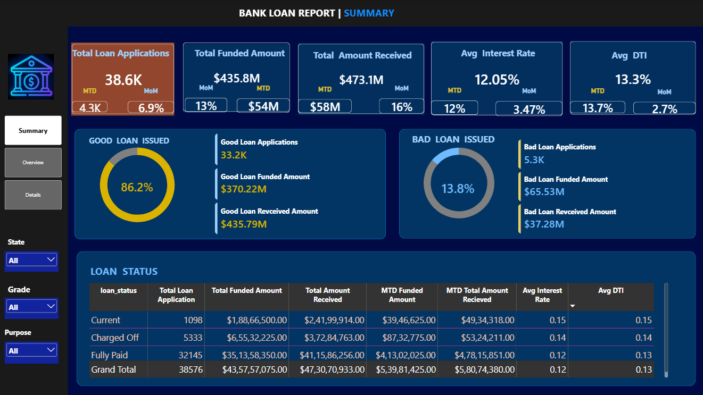
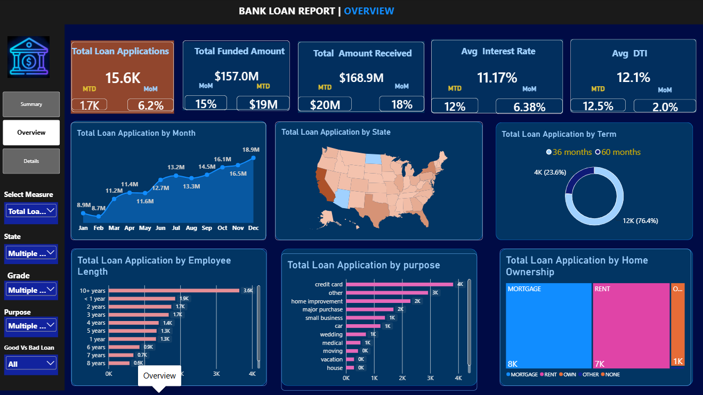
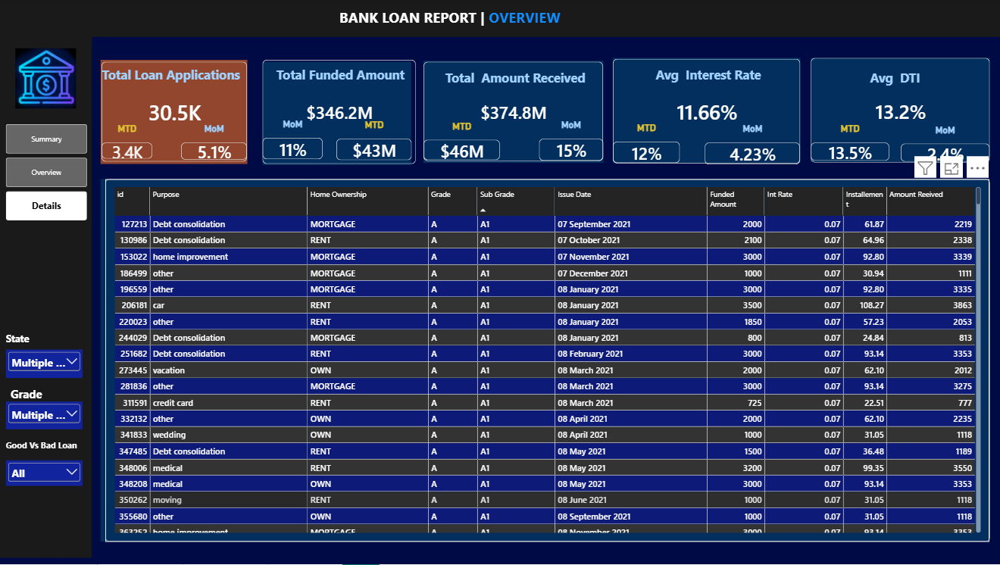

# Bank-Loan-Analysis
Bank Loan Analysis Dashboard using Power BI
# Bank Loan Analysis Dashboard | Power BI

## Project Overview
This project focuses on analyzing bank loan applications, funded amounts, loan repayments, borrower details, and loan performance using Power BI.

The dashboard provides interactive insights into loan applications, good loans, bad loans, loan distribution, and financial performance.

## Project Objectives
- Analyze total loan applications and funded amounts.
- Understand loan repayment performance.
- Identify good loans and bad loans.
- Analyze loan trends over time.
- Explore loan distribution by state, purpose, term, and borrower profile.
- Support data-driven business decisions.

## Business Problem
Banks need to monitor loan applications, funding, repayment performance, and borrower risk. This dashboard helps understand loan portfolio performance and identify patterns in lending activities.

## Dataset
- Dataset: Financial Loan Dataset
- Total Loan Applications: 38,576
- Data Format: CSV
- **Dataset File: ** [financial_loan.csv](Dataset/financial_loan.csv)

## Tools & Technologies
- Power BI
- Power Query
- DAX
- Data Cleaning
- Data Visualization
- Data Analysis

## Key Performance Indicators (KPIs)
- Total Loan Applications
- Total Funded Amount
- Total Amount Received
- Average Interest Rate
- Average Debt-to-Income (DTI)
- Good Loan Applications
- Bad Loan Applications
- Month-to-Date (MTD) Analysis
- Month-over-Month (MoM) Analysis

## Dashboard Pages

### 1. Summary Dashboard
Provides an overall summary of loan portfolio performance.

Key metrics:
- Total Loan Applications
- Total Funded Amount
- Total Amount Received
- Average Interest Rate
- Average DTI
- Good Loan Percentage
- Bad Loan Percentage

### 2. Overview Dashboard
Provides detailed analysis of loan applications using interactive visuals.

Visualizations:
- Loan Applications by Month
- Loan Applications by State
- Loan Applications by Loan Term
- Loan Applications by Employee Length
- Loan Applications by Purpose
- Loan Applications by Home Ownership

### 3. Details Dashboard
Provides detailed loan-level information including:
- Loan ID
- Loan Purpose
- Home Ownership
- Grade and Sub-Grade
- Issue Date
- Funded Amount
- Interest Rate
- Installment
- Amount Received

## Data Cleaning & Preparation
- Checked and prepared dataset for analysis.
- Reviewed missing and blank values.
- Checked duplicate records.
- Corrected data types.
- Prepared date fields for analysis.
- Organized data for Power BI reporting.

## Analysis & Implementation
1. Imported the financial loan dataset.
2. Performed data cleaning and preparation.
3. Created DAX measures for KPIs.
4. Developed interactive dashboard visuals.
5. Added slicers and filters.
6. Designed three dashboard pages.
7. Analyzed loan performance and borrower characteristics.

## Key Insights
- Approximately 38.6K loan applications were recorded.
- Total funded amount was approximately $435.8M.
- Total amount received was approximately $473.1M.
- Average interest rate was approximately 12.05%.
- Average DTI was approximately 13.3%.
- Good loans represented approximately 86.2% of applications.
- Bad loans represented approximately 13.8% of applications.
- Loan applications were analyzed across different purposes, states, terms, and borrower profiles.

## Business Recommendations
- Monitor bad loan applications to improve risk assessment.
- Analyze repayment performance regularly.
- Identify loan purposes with higher risk.
- Monitor borrower financial profiles.
- Use monthly trends for better lending decisions.

## Skills Demonstrated
- Data Cleaning
- Data Analysis
- DAX Measures
- Power BI Dashboard Development
- KPI Reporting
- Data Visualization
- Business Insights
- Analytical Thinking

## Dashboard Screenshots

### Summary Dashboard

### Overview Dashboard

### Details Dashboard

## Project Files
- `financial_loan.csv` – Dataset used for analysis.
- `powerfinance.pbix` – Power BI dashboard file.
- `Screenshots/` – Dashboard screenshots.

## Conclusion
This project demonstrates how Power BI can be used to analyze financial loan data, track key performance indicators, visualize loan trends, and generate meaningful business insights.

## Author
**Shreya Singh**

Aspiring Data Analyst | B.Tech Student

Skills: Power BI | SQL | Excel | Data Analytics
